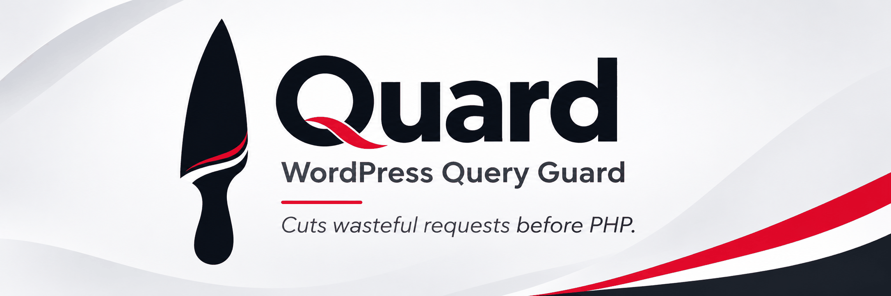
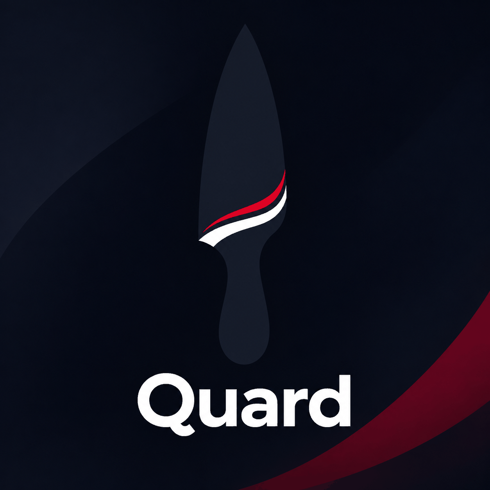

# Quard

**Cut wasteful requests before they cut into your server.**

Quard is a WordPress Query Guard built for an expensive but familiar problem: bots and crawlers requesting endless filter combinations, sorting permutations and other dynamic URLs that may keep WooCommerce, PHP and the database busy for little benefit.

Instead of asking WordPress to handle every unwanted request, Quard lets you define the policy in WordPress and enforce supported rules at **Nginx, before PHP**.

## Two knives. One purpose.

| **Sharp Knife** | **Dull Knife** |
| --- | --- |
| Denies selected cold dynamic URLs before PHP while allowing regular browsing to establish clearance. | Lets crawlers visit normal content while selectively denying specified dynamic-query patterns. |
| Protects against direct dynamic URL spraying. | Helps reduce wasteful, well-intentioned crawling. |

Optional trusted crawler exemptions require **both official IP ranges and matching crawler User-Agents**, not a claimed User-Agent alone. Dull Knife rules may override crawler exemptions for configured URL patterns.

## What you can control

- Exact query parameter names and prefix-style patterns, such as `min_price`, `max_price`, `filter_*` and `query_type_*`.
- Cold request behavior, navigation clearance lifetime and explicit exclusions.
- Bot patterns, dynamic-query patterns and bot-specific response codes for Dull Knife.
- Policy exports, deployment status and diagnostic HTTP probes.

Quard focuses on **resource-heavy dynamic requests**—not blocking ordinary pages or replacing full-page caching, a WAF or a bot-management platform.

## Installation

1. Install the plugin via WordPress and open **Settings → Quard**.
2. Configure and save the intended policy.
3. Export the generated Nginx `http`, `server` and response-header snippets.
4. Install them as an administrator in the correct Nginx contexts. Preserve existing Virtualmin/hosting-panel, caching, bot-blocking and PHP-FPM settings.
5. Run `nginx -t`, reload only if validation succeeds and test real browsing.
6. Use **Test Protection** to check the basic HTTP flows, then verify actual menus, cart, checkout and any payment callbacks yourself.

**Important:** Saving WordPress settings does **not** deploy server rules. Deactivating Quard does **not** remove already installed Nginx directives. Keep a rollback copy of your previous configuration.

## Compatibility and limits

| Platform | Status |
| --- | --- |
| Nginx | Primary supported deployment path; requires administrator-controlled configuration |
| Apache 2.4 | Limited uncached profile tested; cached deployment unqualified |
| LiteSpeed Enterprise | Live qualification incomplete; do not assume feature parity |
| OpenLiteSpeed | Deferred |

Dull Knife and trusted crawler exemptions currently require Nginx. Nginx optional throttling has further capability constraints and may be refused on servers with existing rate-limit rules.

The navigation cookie is intentionally lightweight and **forgeable**. It is not human authentication, and sophisticated automated clients may obtain it. Crawler-specific denial can have SEO consequences; review any configured 403/410 behavior and intentionally indexable filtered landing pages.

## Screens and branding

The project branding uses a simple knife with a restrained red edge. WordPress.org banner and icon assets are held separately from plugin runtime files.

## Development and contributions

Focused issues and pull requests are welcome. Read [CONTRIBUTING.md](CONTRIBUTING.md), [SECURITY.md](SECURITY.md) and [DULL-KNIFE.md](DULL-KNIFE.md).

Maintained by **mohsengham** · Licensed under **GPL-2.0-or-later**.
